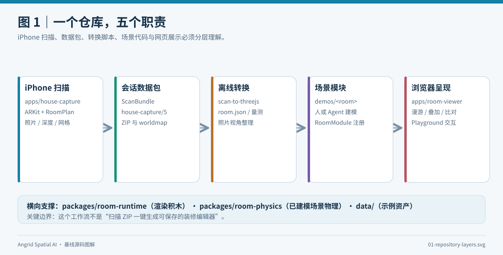
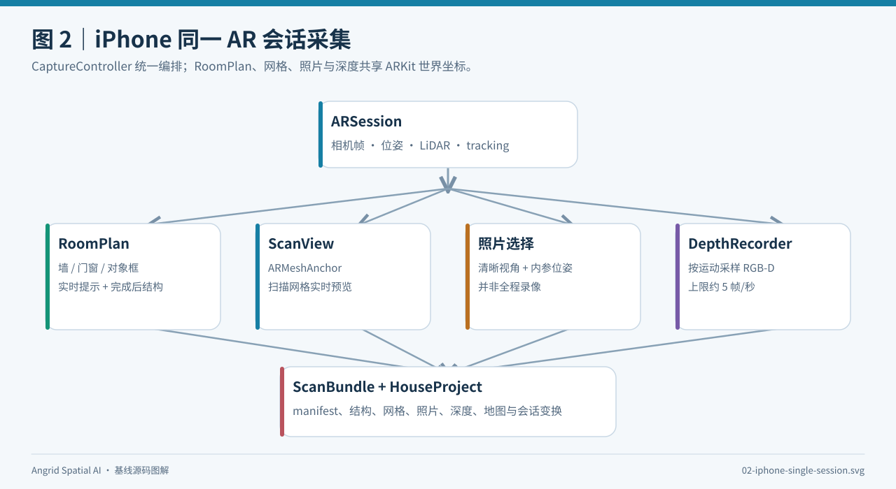
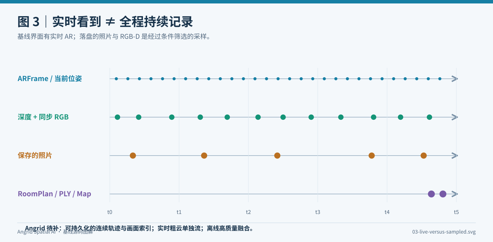
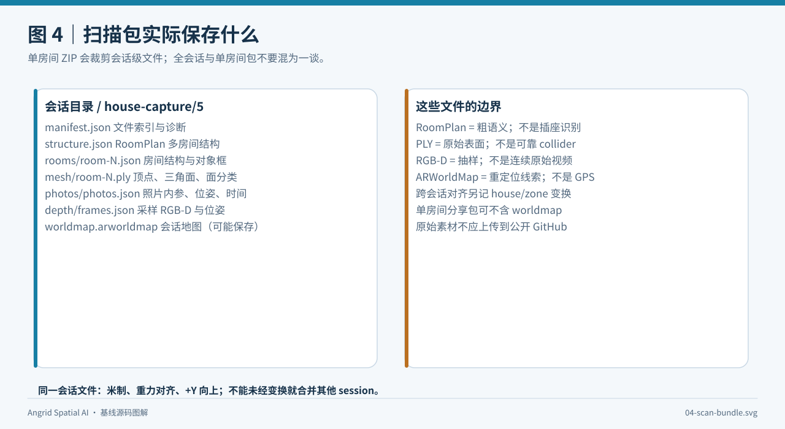
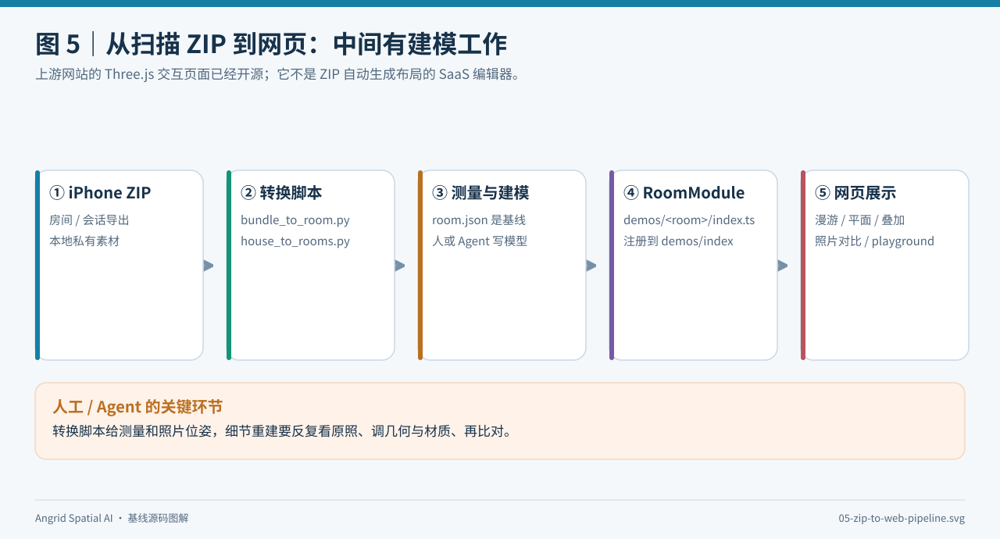
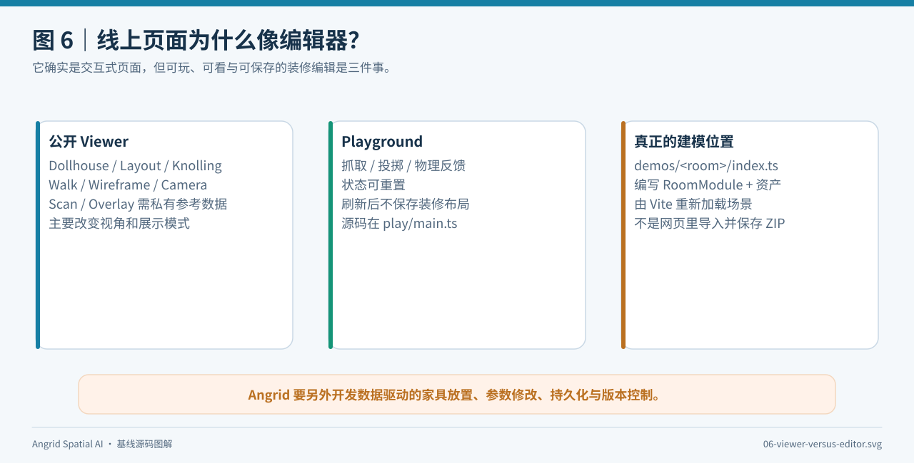
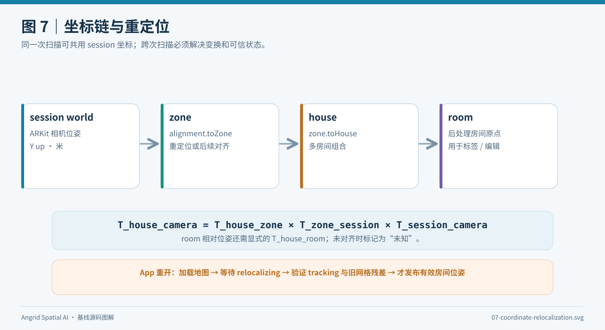
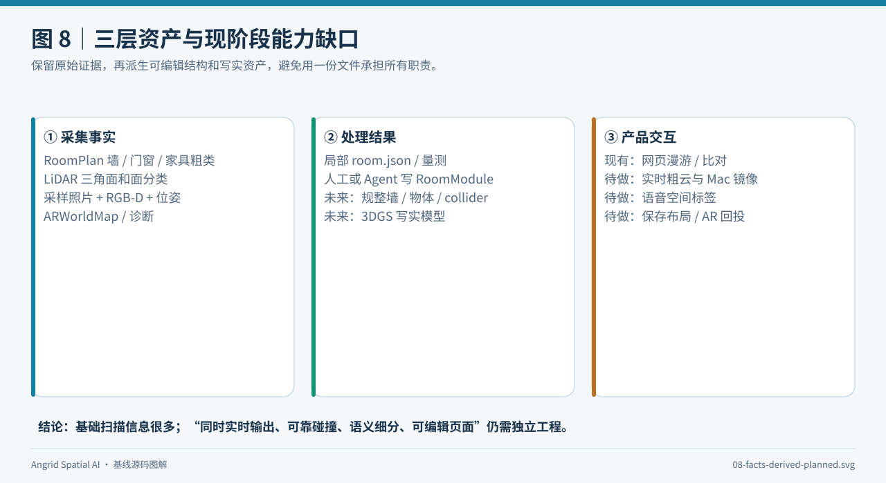
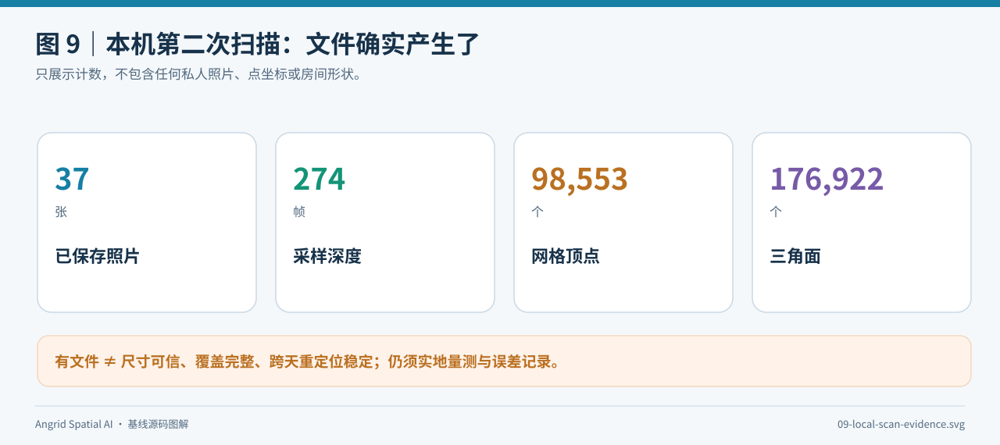

# 3D Model Anything 基线图解报告

> 阅读目标：看懂这份基线**如何扫描、如何保存、如何把扫描变成网页场景**，以及哪些能力已经存在、哪些还只是 Angrid 的下一步。图均为本报告原创示意图，不包含私人房间的照片、网格、点坐标或上游办公室素材。核对版本为本仓库 [上游快照](../reference/README.md) 所记录的 `31b2dc9` 与四处本机修复；截至 2026-11-13，第二次 iPhone 15 Pro 扫描已产出非空网格。

## 先看一句话

3D Model Anything 的“扫描 → 可编辑 Three.js 房间”是**由多个阶段组成的工作流**：iPhone 端保存可测量的证据；脚本把 RoomPlan 和相机数据转成工作资料；人或 Agent 参考照片、尺寸写出场景代码；网页最后加载场景并提供多种查看、比对和试玩方式。它不是手机扫描结束后自动在网页生成一间可保存的新装修房间。上游 [README](../reference/3d-model-anything/README.md) 和 [scan-to-threejs 工作流](../reference/3d-model-anything/.agents/skills/scan-to-threejs/SKILL.md) 都明确区分“转换得到测量基线”和“进一步建模、照片对照”。

**图 1｜源码层次总览。** 左边是原生扫描，中间是扫描包和离线转换，右边是场景代码与网页。底部的 runtime 和 physics 为已建模场景提供渲染、物理能力，不能自动从 LiDAR 原始面片生成施工可用的碰撞体。

| 层 | 主要源码 | 它真正做什么 |
| --- | --- | --- |
| iPhone 扫描 | [apps/house-capture](../reference/3d-model-anything/apps/house-capture/README.md) | SwiftUI 界面、ARKit/RoomPlan、网格覆盖预览、照片和深度采集、房屋/会话管理 |
| 扫描包 | [ScanBundle.swift](../reference/3d-model-anything/apps/house-capture/HouseCapture/ScanBundle.swift)、[HouseProject.swift](../reference/3d-model-anything/apps/house-capture/HouseCapture/HouseProject.swift) | 保存结构、网格、位姿、照片、深度、地图及会话间变换，供 ZIP 分享 |
| 离线整理 | [bundle_to_room.py](../reference/3d-model-anything/.agents/skills/scan-to-threejs/scripts/bundle_to_room.py)、[house_to_rooms.py](../reference/3d-model-anything/.agents/skills/scan-to-threejs/scripts/house_to_rooms.py) | 把一个房间或整屋记录转为房间坐标下的量测资料；拒绝假定不同 session 自动同轴 |
| 人/Agent 建模 | [scan-to-threejs/SKILL.md](../reference/3d-model-anything/.agents/skills/scan-to-threejs/SKILL.md)、[demos/index.ts](../reference/3d-model-anything/demos/index.ts) | 用扫描证据编写 RoomModule，反复与原始照片比较，再注册到网页 |
| 网页交互 | [apps/room-viewer](../reference/3d-model-anything/apps/room-viewer/index.html)、[room-runtime](../reference/3d-model-anything/packages/room-runtime/types.ts)、[room-physics](../reference/3d-model-anything/packages/room-physics/physics.ts) | 展示、漫游、平面图、对照、物理试玩；尚无通用“导入 ZIP 并保存家具布局”的产品界面 |

## 一、iPhone 到底在同一趟扫描里干了什么

核心在 [CaptureController.swift](../reference/3d-model-anything/apps/house-capture/HouseCapture/CaptureController.swift)：它持有 ARKit 的 ARSession，并把同一个 session 交给 RoomCaptureSession。这样 RoomPlan 的墙、门窗、物件框，与 ARKit 相机位姿、LiDAR 深度及网格有共同的会话世界坐标。界面通过 [CaptureScreen.swift](../reference/3d-model-anything/apps/house-capture/HouseCapture/CaptureScreen.swift) 和 [ScanView.swift](../reference/3d-model-anything/apps/house-capture/HouseCapture/ScanView.swift) 显示状态、网格与照片覆盖；[CoverageEngine.swift](../reference/3d-model-anything/apps/house-capture/HouseCapture/CoverageEngine.swift) 聚合网格并保存 PLY。所谓“一次扫描得到多路”，关键是**同一 ARSession 的时间和坐标来源**，而不是多款 App 各扫一遍后拼接。

**图 2｜传感器到扫描包。** RoomPlan 输出结构化的粗语义；ScanView 使用 ARMeshAnchor 做实时表面预览；照片与 RGB-D 按条件采样；ScanBundle 保存可复查的文件。RoomPlan 可以识别有限类别的墙、门、窗、开口和部分物件，但不认识“这个插座属于哪个施工回路”，也不提供万能物体切分。

“实时”与“完整录制”容易混淆。ARFrame 持续到达，屏幕因此能跟着手机运动；但基线为控制存储、耗电和质量，只保存选择后的照片，DepthRecorder 在移动/旋转达到条件时才记录 RGB-D，默认间隔约 0.2 秒且会受追踪与写入状态限制。相机位姿在界面中更新，不等于硬盘保存每一帧的完整轨迹或同步视频。源码入口：[ScanView.swift 的 DepthRecorder](../reference/3d-model-anything/apps/house-capture/HouseCapture/ScanView.swift)、[CaptureController.swift](../reference/3d-model-anything/apps/house-capture/HouseCapture/CaptureController.swift)。

**图 3｜为什么不能直接把采样帧称为实时流。** Angrid 想要 Pixel-UMI 风格的“轨迹 + 画面 + 粗点云”现场显示，需要在现有扫描控制器之外增加连续事件记录、可节流的预览流和独立粗云缓存。干净的静态彩色点云还要处理位姿漂移、动态人/物和空洞，适合扫描后在 Mac 精化。图中的点距仅示意采样差异，不代表真实设备的固定帧率。

## 二、扫完以后留下的不是一张图，而是一组有关系的文件

会话级目录遵循上游 `house-capture/5` 数据约定。它把 RoomPlan 编码的房间 JSON/USDZ、会话级结构、含三角面和逐面分类的 mesh PLY、带内参/位姿/时间戳的照片索引、采样 RGB-D、manifest 和可能成功保存的 ARWorldMap 放在同一目录。**单房间分享 ZIP 与整个 session 导出内容不同**：上游代码明确会裁剪其他房间及会话级结构/地图，因此“在原始会话目录里看到 worldmap”不代表单房间 ZIP 一定带图。来源：[ScanBundle.swift](../reference/3d-model-anything/apps/house-capture/HouseCapture/ScanBundle.swift) 与 [House Capture 格式说明](../reference/3d-model-anything/apps/house-capture/README.md)。

**图 4｜文件分别是证据，不是最终答案。** PLY 保存的是采样到的表面：有三角面，但可能有洞、漂浮面、错误分类。RoomPlan 对象框有类别和尺寸，却不等于精细家具网格。ARWorldMap 是下次尝试重定位的地图，不能当作“即使关机也持续知道手机位置”。要判断通道宽、门扇干涉和安装尺寸，必须清理、建模、量尺并显示未知区域。

## 三、从 ZIP 到网页，为何还需要人或 Agent

解压 iPhone 包后，上游建议把私人扫描放到 Git 忽略的 `data/captures-in/`。 [bundle_to_room.py](../reference/3d-model-anything/.agents/skills/scan-to-threejs/scripts/bundle_to_room.py) 将单房间结构/照片变到房间坐标；[house_to_rooms.py](../reference/3d-model-anything/.agents/skills/scan-to-threejs/scripts/house_to_rooms.py) 处理跨 session 的整屋放置；必要时还有[照片准备和比较脚本](../reference/3d-model-anything/.agents/skills/scan-to-threejs/SKILL.md)。这些步骤生成量测、照片视角等**建模依据**。再由人或 Agent 按尺寸与照片构建 `demos/<room>/index.ts` 的 RoomModule，并在 [demos/index.ts](../reference/3d-model-anything/demos/index.ts) 注册，网页才会加载该房间。上游当前注册的是 office-v4 示例。

**图 5｜橙色“测量与建模”是关键人工环节。** 脚本不把照片自动变成可信的椅子、冰箱、插座和门铰链。Agent 工作流强调多张照片、测量、模型比对与修正，因此网页展示精致办公室，是有人做过详细建模的结果，而不是每个新扫描的即时通用输出。

## 四、为什么官网看起来像编辑器

你看到的交互是真实的，也**已经开源**：[网页 HTML](../reference/3d-model-anything/apps/room-viewer/index.html)、[主交互逻辑](../reference/3d-model-anything/apps/room-viewer/src/main.ts)、[物理试玩入口](../reference/3d-model-anything/apps/room-viewer/play.html)和[物理试玩代码](../reference/3d-model-anything/apps/room-viewer/src/play/main.ts)都在快照中。Dollhouse、Layout、Knolling、Walk、Wireframe、Camera 等模式可以看房间的不同侧面；Playground 可以抓取、投掷、重置已建模物体。**这里的“能交互”与“能持久编辑装修方案”不是同一层能力**。Layout 的拖动是平移平面图，[layout.ts](../reference/3d-model-anything/apps/room-viewer/src/layout.ts) 中修改的是 SVG 视口；主页面只把相机视角留在浏览器 sessionStorage，没有家具布局的保存/加载契约。公开办公室示例没有原始扫描/照片，因此 Scan/Overlay 模式被禁用。

**图 6｜三个“看似编辑”的层次。** 左边 Viewer 提供观察和对照，中间 Playground 提供临时物理互动，右边源码中的 RoomModule 才是当前精细场景的真正编辑处。Angrid 若要让设计师在 Mac 浏览器里拖动家具并保存，需要新增对象选择、变换控件、参数化 JSON、碰撞检查、撤销/版本与持久化；这部分不在现成页面中。

## 五、坐标系是两端能否对上的前提

上游把一次扫描固定在 ARKit session 世界系：米、重力对齐、+Y 向上。跨 session 时，`HouseProject.toHouse` 以 `zone.toHouse × session.alignment.toZone` 把会话坐标放到 house 坐标；未对齐会话应保留“未对齐”状态，不可按房间名字硬拼。离线脚本还会建立房间局部坐标，将几何和照片位姿一起变换。重开 App 后读取 ARWorldMap 只是重定位尝试；必须恢复正常追踪并通过原场景核对，才能再次把当前 AR 位姿赋予旧房间含义。来源：[HouseProject.swift](../reference/3d-model-anything/apps/house-capture/HouseCapture/HouseProject.swift)、[Relocalization.swift](../reference/3d-model-anything/apps/house-capture/HouseCapture/Relocalization.swift)和[扫描格式说明](../reference/3d-model-anything/apps/house-capture/README.md)。

**图 7｜位置不是一个孤立的 XYZ。** 对 Angrid 的语音插座标注、网页方块布局和 iPhone AR 回投，至少要保存对象的房间局部变换与当次 AR 会话到房间的变换；定位失败时不能显示“精确放回原处”的假象。

## 六、哪些能力已经有，哪些仍要开发

**图 8｜把“扫描事实”与“派生产品能力”分开。** 基线已经给了非常有价值的原料：RoomPlan 粗语义、带三角面和面分类的 LiDAR mesh、照片、采样深度与位姿、世界地图。它还没内置 Angrid 需要的持续全量轨迹/视频、实时粗彩色点云流、语音空间标签、Mac 实时镜像、3DGS 训练、自动可信碰撞体和可保存的装修编辑器。

| Angrid 需求 | 先从基线拿什么 | 还缺什么 |
| --- | --- | --- |
| 房间相对位姿可恢复 | ARKit 位姿、ARWorldMap、house/zone/session 变换 | 持续记录房间位姿、明确跟踪状态、重启后的重定位验收 |
| 轨迹、画面、实时粗点云 | 采样照片与 RGB-D、相机内参和位姿、实时网格 | 连续画面/轨迹索引、按时间对齐的预览流、独立增量彩色粗云 |
| 网格及包围盒 | 已有三角面 PLY、RoomPlan 墙/开口/对象框 | 可审计的清理/简化碰撞体，区分未知区后再求整体范围 |
| 语义和物体切分 | RoomPlan 有限类别、ARKit 面分类 | 插座等现场人工标签、物体实例匹配与细粒度分割 |
| 3DGS 和 AR 回投 | 同会话照片/深度/姿态、当前 AR 世界 | 扫描后训练、统一 room 坐标、AR 重定位、遮挡与误差检查 |
| Mac 编辑 | 离线展示/比对脚本与 Three.js runtime | 低延迟旁观流、可靠包传输、数据驱动编辑器与保存机制 |

本机第二次扫描的**非敏感计数**可以用来检验“链路是否产生了数据”，不能用来替代精度测试：37 张保存照片、274 帧采样深度、98,553 个网格顶点、176,922 个三角面，原始会话含 worldmap 文件。第一次扫描曾出现空 PLY，本地网格送入修复后第二次才非空；详情见 [参考快照说明](../reference/README.md)。

**图 9｜文件计数的意义与限制。** 至少验证了输出“不是空网格”；尚需卷尺校验墙长/门洞、检查遮挡和反光区域、评估坐标跳变、重启恢复及 3DGS 输入视角覆盖。报告没有发布任何私人扫描原件。

## 给 Angrid 的落地顺序

1. **保住事实层。** 从 House Capture 基线延伸 iPhone 采集与扫描包，不破坏已有 RoomPlan、网格、照片、深度、世界地图及错误诊断。把第一份真实扫描包的重投影和尺寸误差测出来。
2. **增加有边界的实时层。** iPhone 本地逐帧位姿/画面和粗云先可靠落盘；Mac 先只读地看节流后的相机视锥、粗云/网格与缩略画面。预览允许跳过过时帧，完整资产继续走 ZIP 或经过校验和的分块传输。不要让网络状态影响手机采集。
3. **建设可编辑的结构层。** 以 RoomPlan 墙段/门窗开口及家具定向盒体为参数化基础，保留原始 mesh 作复核证据；网页对象要有稳定 ID、尺寸、房间变换、来源和撤销/保存记录。把扫描 mesh 自动切成完美盒体属于后期研发，不是入门显示功能。
4. **再做写实和现场回投。** 在同一批照片/位姿上试训 3DGS；语音标签和网页编辑的物体要相对 room 坐标存储，iPhone 重定位成功后才重新渲染到 AR。真实物体遮挡、跨日位置偏差和施工尺寸必须单独验收。

这一顺序保留上游最强的“两端基础”，也避免把好看的 Viewer 误当成已经完成的空间数据库和装修求解器。
